<!-- animated contribution graph + stats card: real data, regenerated daily by
     .github/workflows/update-profile-art.yml -->

<h3><code>pixelanay@github ~ $ ./contributions.sh</code></h3>

 
 

<h3><code>pixelanay@github ~ $ ./stats.sh</code></h3>

 
 

<h3><code>pixelanay@github ~ $ whoami</code></h3>

<b>Anay Gawate</b>

I build things that should exist: apps, systems, and occasionally RC planes. 
Most of what I know came from just doing it.

 

<h3><code>pixelanay@github ~ $ ./links.sh</code></h3>

 

